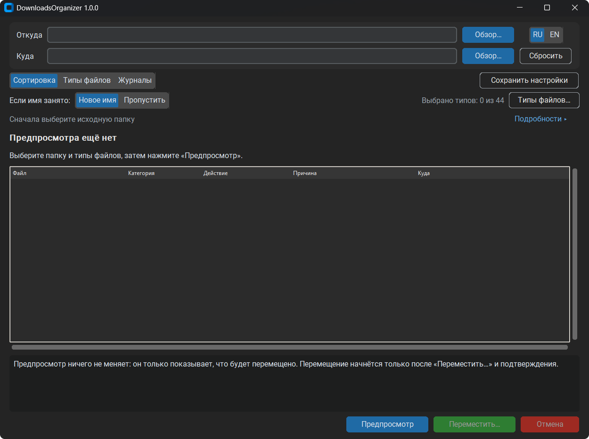
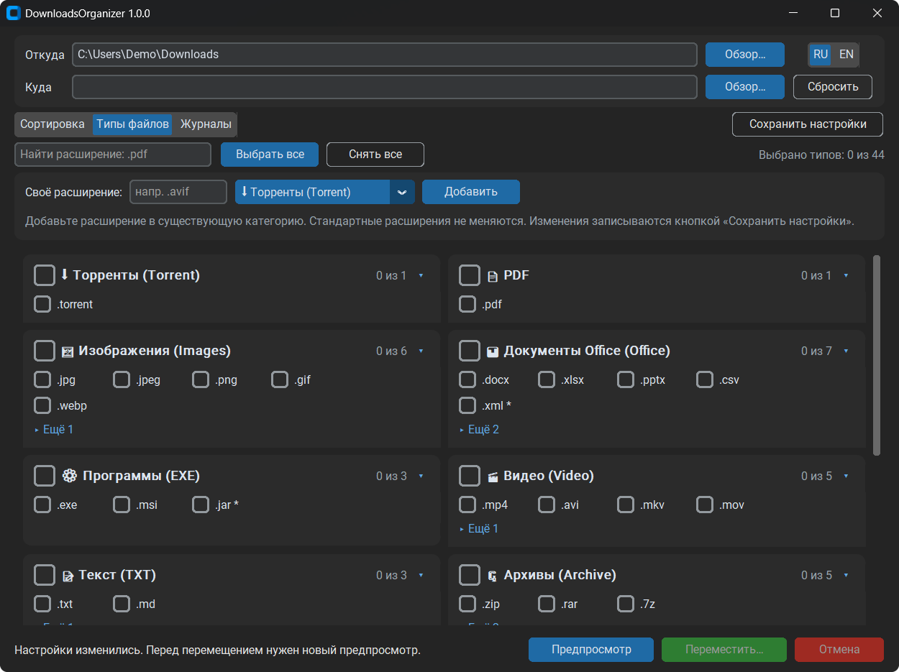
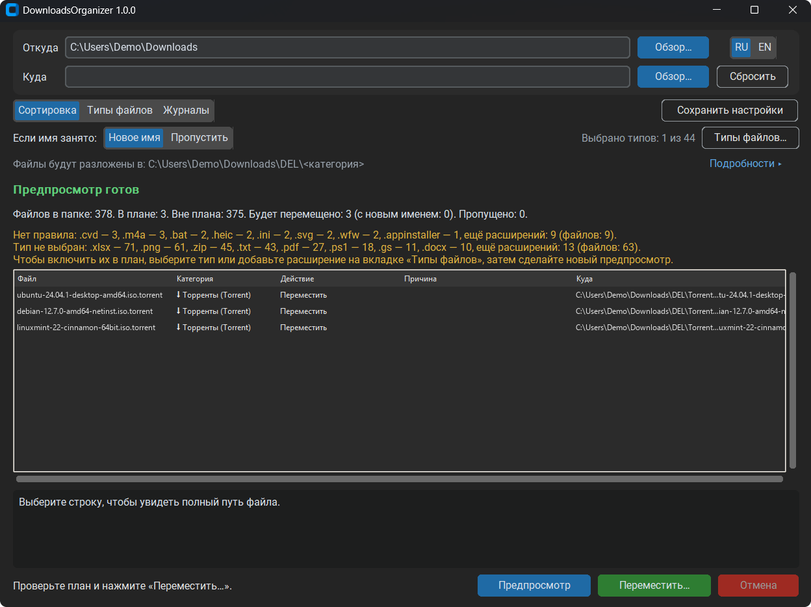

# DownloadsOrganizer

**Программа для удобной сортировки файлов, которые накапливаются в папке «Загрузки» (Downloads) в Windows.**

[English version](README.md) · [Скачать v1.0.0](https://github.com/Omaeon/DownloadsOrganizer/releases/tag/v1.0.0) · [Лицензия MIT](LICENSE)

## Зачем создавался проект

Почти у каждого со временем засоряется папка **Downloads**: документы, фотографии, архивы, установщики и множество файлов с непонятными названиями. Найти нужную загрузку становится всё сложнее.

**DownloadsOrganizer** создан, чтобы упростить наведение порядка. Вы выбираете папку, просматриваете план сортировки и только затем подтверждаете перемещение файлов по категориям. Главный принцип — понятные и предсказуемые действия, а не фоновая автоматическая перестановка файлов без ведома пользователя.

У проекта есть и вторая цель: проверить, насколько далеко можно продвинуть реальную разработку программы с помощью **организованной команды ИИ-инструментов**. Владелец ставил задачи и утверждал результаты; ChatGPT координировал этапы, Claude Code реализовывал программу, а Codex CLI независимо проверял изменения.

## Возможности

- **Предпросмотр до перемещения:** можно увидеть планируемые действия и конечные пути.
- **Явное подтверждение:** выбор папки и предпросмотр сами по себе не запускают перенос.
- **Сортировка по типам файлов:** готовые категории и возможность добавлять собственные расширения.
- **Обработка совпадающих имён:** создать новое имя или пропустить файл. Существующие файлы в назначении не должны перезаписываться.
- **Защита от изменения файлов:** если метаданные файла изменились после предпросмотра, перенос этого файла пропускается; можно обновить план.
- **Журналы операций:** результаты перемещения, пропуски и причины доступны в интерфейсе.
- **Русский и английский языки интерфейса.**
- **Портативная сборка Windows:** без установки Python и без инсталлятора.

## Скриншоты

**Главное окно.** Здесь выбирают исходную папку (**«Откуда»**), при необходимости папку назначения (**«Куда»**), язык интерфейса и действие при совпадении имён.



**Выбор типов файлов.** Отметьте типы файлов для сортировки, сгруппированные по категориям, или добавьте собственное расширение в существующую категорию.



**Предпросмотр сортировки.** До перемещения программа показывает каждый файл, его категорию, планируемое действие и путь назначения, а также файлы, которые не попали в план, и причину.



*Пути и имена файлов на скриншотах — демонстрационные.*

## Скачивание и запуск

**Платформа:** Windows x64. Основной формат первой версии — ZIP с готовой portable-программой.

1. Откройте [страницу релиза v1.0.0](https://github.com/Omaeon/DownloadsOrganizer/releases/tag/v1.0.0).
2. Скачайте `DownloadsOrganizer-1.0.0-win-x64-portable.zip` и `SHA256SUMS.txt`.
3. Распакуйте архив в папку с коротким путём, например `C:\Apps\DownloadsOrganizer`. Не отделяйте `DownloadsOrganizer.exe` от папки `_internal`.
4. Запустите `DownloadsOrganizer.exe`.

Устанавливать Python **не нужно**. EXE пока **не имеет цифровой подписи**, поэтому Windows может показать предупреждение системы безопасности. Не отключайте антивирус или средства защиты Windows ради запуска программы.

### Проверка скачанного архива

В PowerShell, находясь в каталоге со скачанным файлом:

```powershell
Get-FileHash .\DownloadsOrganizer-1.0.0-win-x64-portable.zip -Algorithm SHA256
```

Контрольная сумма SHA-256 исходного проверенного архива v1.0.0:

```text
9f93dbb6d9faeade3dd73bf9822f01949e36ce3168cb011aa575fc0e0a5d6d88
```

Сравните всё значение с опубликованной контрольной суммой. Если оно отличается, скачанный файл не идентичен проверенному архиву.

## Как пользоваться

1. В поле **«Откуда»** выберите папку с файлами.
2. При необходимости укажите папку **«Куда»**. Если поле оставить пустым, программа показывает стандартный путь назначения внутри исходной папки — подпапка `DEL` с категориями.
3. На вкладке **«Типы файлов»** выберите нужные типы. Если не выбран ни один тип, перемещение блокируется.
4. Выберите поведение при совпадении имён: **«Новое имя»** или **«Пропустить»**.
5. Нажмите **«Предпросмотр»** и проверьте действия и пути назначения.
6. Нажмите **«Переместить…»**, изучите окно подтверждения и подтвердите операцию.
7. Проверьте результат и вкладку **«Журналы»**. Если некоторые файлы изменились после предпросмотра, обновите его и заново оцените план.

Пример стандартной структуры (схематично):

```text
Downloads/
├── report.pdf
├── picture.jpg
└── DEL/
    ├── PDF/report.pdf
    └── Images/picture.jpg
```

Пользовательские настройки сохраняются по явной кнопке **«Сохранить настройки»**. В текущей версии **выбор типов файлов между запусками не сохраняется**, поэтому после повторного открытия программы проверьте его заново.

## Безопасность и ограничения

Перед сортировкой важных данных учитывайте следующее:

- **Версия 1.0.0 перемещает файлы только внутри одного тома (MOVE).** Копирование между дисками (COPY) отключено.
- Любое перемещение требует актуального предпросмотра и отдельного подтверждения.
- Если исходный файл изменился после предпросмотра, программа может пропустить его вместо перемещения.
- При конфликте имён файл можно переименовать или пропустить; существующий файл не должен намеренно перезаписываться.
- **Автоматического отката выполненных перемещений нет.** Функции автоматического восстановления или Undo также нет. Проверяйте план и делайте резервные копии важных данных.
- Файлы могут остаться без обработки, если для них не выбраны подходящие типы или правила.
- Portable означает запуск без установки; **настройки и журналы размещаются в `%LOCALAPPDATA%\DownloadsOrganizer`**, а не рядом с EXE.
- Слишком длинный путь распаковки может повлиять на загрузку шрифтов CustomTkinter; рекомендуется короткий путь.
- Программа тестировалась на рабочем компьютере с Windows и масштабом интерфейса 125%. Запуск на чистой Windows, Windows 10 и масштабы 100%/150% отдельно не проверялись.

## Как мы разрабатывали программу при помощи ИИ

Особенность проекта — почти весь технический процесс разработки был построен вокруг совместной работы ИИ-инструментов. Владелец определял требования, ограничения безопасности и принимал решения о выпуске. ИИ-ассистенты выполняли координацию, написание кода и независимый аудит.

| Роль | Инструмент / конфигурация по журналу проекта |
|---|---|
| **Координатор** | **ChatGPT — GPT-6 High** |
| **Разработчик** | **Claude Code — Opus 5.5 High** |
| **Независимая проверка кода** | **Codex CLI — GPT-6.1-Sol Medium** |

**Наша схема разработки:**

```text
Владелец проекта / постановка задачи
                ↓
ChatGPT — координация, границы изменений, критерии приёмки
                ↓
Claude Code — реализация, тесты, сборка
                ↓
Codex CLI — независимый аудит в режиме ReadOnly
                ↓
ChatGPT — разбор замечаний, решение о приёмке
                ↺ адресные исправления при необходимости
```

Чтобы не застревать в бесконечных циклах проверок, мы установили **рабочий лимит: максимум три адресные итерации исправлений на этап**:

- **High:** до двух итераций исправлений.
- **Medium:** до одной итерации.
- **Low:** фиксируются как замечания, без обязательного дополнительного цикла.

Подтверждённые **Critical/High**, влияющие на выпускаемую функциональность, оставались блокирующими: лимит итераций не служил основанием игнорировать опасные дефекты. Указанные названия моделей приведены по данным журнала разработки, а не как независимая оценка их возможностей.

Идея эксперимента — не заменить ответственность человека, а проверить процесс **ИИ-координатор → ИИ-разработчик → независимый аудит → решение владельца** на настоящей программе для Windows.

## Исходный код и участие в проекте

Исходный код опубликован под лицензией MIT: его можно изучать, использовать, изменять и распространять с соблюдением лицензионных условий. Проект использует Python, CustomTkinter и PyInstaller для Windows-сборки. Зависимости зафиксированы в `pyproject.toml` и `uv.lock` (Python 3.14); среду разработки можно создать командой `uv sync`.

В подготовленной среде разработки автотесты запускаются командой `python -m pytest`. Создание Windows-сборок зависит от окружения и конфигурации проекта.

Если обнаружите ошибку, создайте [GitHub Issue](https://github.com/Omaeon/DownloadsOrganizer/issues), указав версию программы, версию Windows, последовательность действий и ожидаемый результат. **Перед публикацией удалите из скриншотов и журналов личные имена файлов, пути и другие приватные данные.**

## Лицензия

**Собственный код DownloadsOrganizer — MIT License, Copyright (c) 2026 Omaeon.** Полный текст — в [LICENSE](LICENSE).

Сторонние библиотеки, шрифты и другие компоненты сохраняют собственные лицензии. В portable-архив включены `THIRD_PARTY_NOTICES.txt` и папка `licenses/`. Если отдельно распространяется onefile EXE, вместе с ним должен предоставляться соответствующий архив `onefile-licenses.zip`.

---

*DownloadsOrganizer 1.0.0 — небольшая полезная программа и эксперимент в системной разработке с помощью ИИ.*
